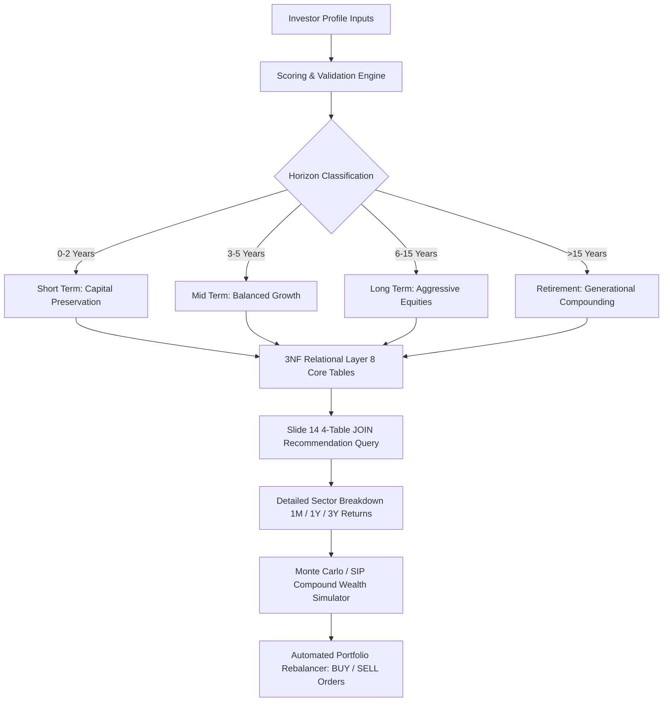

# Smart Investment Advisor — Algorithmic Robo-Advisory & Asset Allocation

[](#-automated-testing--verification)
[](https://opensource.org/licenses/MIT)
[](#)
[](https://react.dev/)

> An institutional-grade algorithmic robo-advisory platform engineered on a strictly normalized Third Normal Form (3NF) relational database, featuring quantitative risk profiling, multi-timeframe asset performance telemetry, Monte Carlo wealth simulation, and automated portfolio rebalancing.

---

## 📋 Table of Contents
- [Architecture & Overview](#-architecture--overview)
- [Key Features](#-key-features)
- [Relational Schema Architecture (3NF)](#-relational-schema-architecture-3nf)
- [Tech Stack](#-tech-stack)
- [System Requirements](#-system-requirements)
- [Quick Start](#-quick-start)
- [Configuration](#-configuration)
- [API Reference & Usage](#-api-reference--usage)
- [Automated Testing & Verification](#-automated-testing--verification)
- [Contributing & License](#-contributing--license)

---

## 🏛️ Architecture & Overview

Smart Investment Advisor automates portfolio generation by mapping personal financial characteristics (age, income, savings, target duration, risk tolerance) to quantitative asset allocation models. The backend enforces strict relational constraints across 8 core database tables and evaluates historical risk-adjusted returns across multiple time horizons.



---

## ⚡ Key Features

1. **8-Table 3NF Normalized Relational Architecture**  
   Implements strict primary key/foreign key referential integrity across 8 core tables: `users`, `user_profiles`, `risk_categories`, `user_categories`, `market_sectors`, `assets`, `asset_performance`, and `category_suggestions`.

2. **Quantitative 4-Pillar Investor Risk Profiling Model**  
   Calculates a composite risk score ($0 \le S \le 100$) based on quantitative risk capacity:
   $$S = \text{AgeFactor}(25) + \text{HorizonFactor}(35) + \text{SavingsFactor}(15) + \text{ToleranceFactor}(25)$$
   Includes financial sanity checks to validate that annualized savings do not exceed stated income.

3. **Multi-Timeframe Historical Return Telemetry**  
   Tracks dated performance records across four analytical horizons: **1 Month**, **1 Year**, **3 Years**, and **5-Year CAGR**, coupled with Sharpe ratio and market beta metrics.

4. **Slide 14: 4-Table Relational JOIN Query Runner**  
   Executes optimized queries joining category suggestions, asset master records, market sectors, and dated performance metrics:
   ```sql
   SELECT 
       a.name AS asset_name, 
       a.asset_class AS asset_type, 
       ms.sector_name AS sector, 
       ap.historical_return, 
       ap.return_1_month,
       ap.return_1_year,
       ap.return_3_years,
       cs.investment_rationale AS rationale, 
       cs.priority AS rank_order
   FROM category_suggestions cs
   JOIN assets a ON a.asset_id = cs.asset_id
   JOIN market_sectors ms ON a.sector_id = ms.sector_id
   JOIN asset_performance ap ON ap.asset_id = a.asset_id
   WHERE cs.category_id = ?
   ORDER BY cs.priority ASC;
   ```

5. **Compound Wealth Simulation & Automated Live Rebalancing**  
   Projects Future Value ($FV$) curves across Optimistic (+3%), Expected, and Conservative (-3%) market conditions, and compares active user portfolio holdings against target category models to issue automated `BUY` and `SELL` rebalancing orders.

---

## 🗄️ Relational Schema Architecture (3NF)

```
[users] (user_id PK)
   │
   ├── (1:1) ──> [user_profiles] (profile_id PK, user_id FK)
   │
   └── (1:N) ──> [user_categories] (user_category_id PK, user_id FK, category_id FK)
                      │
                      └── (N:1) ──> [risk_categories] (category_id PK)
                                         │
                                         └── (1:N) ──> [category_suggestions] (suggestion_id PK, category_id FK, asset_id FK)
                                                            │
[market_sectors] (sector_id PK)                             │
   │                                                        │
   └── (1:N) ──> [assets] (asset_id PK, sector_id FK) <─────┘
                    │
                    └── (1:1) ──> [asset_performance] (performance_id PK, asset_id FK)
```

---

## 🛠️ Tech Stack

- **Runtime & Backend:** Node.js (v20+ / v24+), Express.js
- **Database Engine:** SQLite via native Node `node:sqlite` (`DatabaseSync`), 3NF relational normalization
- **Frontend SPA:** React 19, Vite, Tailwind CSS
- **Design Archetype:** *Tactile Dark-Mode Hardware UI / Moodwave* (Obsidian `#090A0F`, metallic micro-borders, glowing cyan `#06B6D4` & emerald `#10B981` telemetry, Syne display font)
- **Icons:** Lucide React

---

## 💻 System Requirements

- **Node.js:** `>= 20.0.0`
- **npm:** `>= 9.0.0`
- **Operating System:** macOS, Linux, or Windows (pwsh/cmd)

---

## 🚀 Quick Start

### 1. Clone & Enter Repository
```bash
git clone <repository-url> smart-investment-advisor
cd smart-investment-advisor
```

### 2. Install Dependencies
```bash
# Install backend dependencies
cd server && npm install && cd ..

# Install frontend dependencies
cd client && npm install && cd ..
```

### 3. Seed Database
Seed SQLite with 8 normalized relational tables, 12 diversified instruments, and multi-timeframe returns:
```bash
npm run seed
```

### 4. Build Production Frontend
```bash
npm run build
```

### 5. Launch Full-Stack Application
Starts production server serving both API and frontend on port `5003`:
```bash
npm start
# Access web application at: http://localhost:5003
```

### 6. Run Automated Verification Suite
```bash
npm test
```

---

## ⚙️ Configuration

Create a `.env` file in `server/` to configure options:

| Variable | Description | Required | Default |
| :--- | :--- | :---: | :--- |
| `PORT` | HTTP port for backend and SPA | No | `5003` |
| `NODE_ENV` | Environment mode (`development` / `production`) | No | `production` |
| `DB_PATH` | Path to SQLite database file | No | `server/data/advisor.db` |

---

## 🔌 API Reference & Usage

### 1. Retrieve Investor Recommendations
```bash
curl -X GET http://localhost:5003/api/recommendations/usr_01
```
**Response (200 OK):**
```json
{
  "status": "success",
  "data": {
    "user_id": "usr_01",
    "category_id": "cat_long",
    "category_name": "Long Term Horizon",
    "suggestions": [
      {
        "asset_id": "ast_01",
        "ticker": "VOO",
        "asset_name": "Vanguard S&P 500 Index Fund",
        "allocation_weight_pct": 35,
        "return_1_month": 1.8,
        "return_1_year": 24.2,
        "return_3_years": 32.5,
        "cagr_5yr": 14.2
      }
    ]
  }
}
```

### 2. Fetch Detailed Sector Breakdown
```bash
curl -X GET http://localhost:5003/api/sectors/breakdown/cat_long
```

### 3. Run Slide 14 4-Table JOIN Query
```bash
curl -X POST http://localhost:5003/api/sql/slide14-query \
  -H "Content-Type: application/json" \
  -d '{ "categoryId": "cat_long" }'
```

### 4. Compound SIP Wealth Simulation
```bash
curl -X POST http://localhost:5003/api/simulation/compound \
  -H "Content-Type: application/json" \
  -d '{
    "initialPrincipal": 10000,
    "monthlySip": 1000,
    "years": 10,
    "baseCagrPct": 12
  }'
```

---

## 🧪 Automated Testing & Verification

Run the test suite:
```bash
npm test
```
The test suite verifies:
- API health and production SPA HTML delivery on `:5003`
- Investor profiling boundary scoring (Age 80, 1-yr duration $\to$ `cat_short`)
- Multi-timeframe return metrics (1M, 1Y, 3Y) across recommended assets
- Detailed sector breakdown distribution and percentage calculations
- Sub-millisecond execution of the Slide 14 4-table relational `JOIN` query
- Monte Carlo / SIP future value simulation calculations
- Schema introspection across all 9 normalized relational tables

---

## 📄 Contributing & License

Contributions are welcome. Please open an issue or pull request for bugs or enhancements.

This project is licensed under the **MIT License**.
